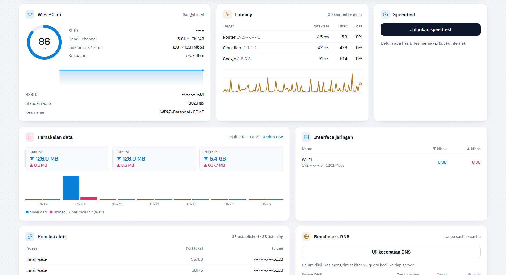

# Netsys Monitor

[English](README.md) · [Changelog](CHANGELOG.md) · [Keamanan](SECURITY.md)

Dashboard **monitoring jaringan dan sistem** yang berjalan lokal di PC Anda (fokus Windows; fitur inti juga jalan di Linux/macOS).
Latency/jitter/loss real-time, kualitas WiFi, CPU/GPU/RAM/disk, **deteksi perangkat asing di WiFi**, traceroute, benchmark DNS,
peringatan dengan diagnosis, ikon system tray, dan `.exe` satu file. Tanpa cloud, tanpa akun, tanpa telemetri.

<p align="center"><br><sub>Screenshot: lihat <a href="docs/screenshots/README.md">docs/screenshots</a></sub></p>

## Fitur
| Area | Isi |
|---|---|
| Jaringan | kecepatan real-time, latency/jitter/loss ke router + Cloudflare + Google, pemakaian data (sesi/harian/bulanan, CSV), koneksi aktif + nama proses, speedtest |
| **Penjaga WiFi** | pindai ARP berkala; MAC baru → peringatan sampai Anda klik *Percayai*; daftar terpisah per jaringan; paham MAC acak; nama pabrikan (OUI IEEE, diunduh atas permintaan); Wake-on-LAN; **peringatan MAC gateway berubah** (indikasi ARP spoofing) |
| **WiFi PC ini** | sinyal %, ≈dBm, band, channel, kecepatan link, BSSID (`netsh wlan` / `nmcli`), peringatan sinyal lemah |
| Diagnosis | traceroute (live, loss per hop, lonjakan latency) dan benchmark DNS (tanpa cache vs cache, dibanding DNS publik) |
| Hardware | suhu/fan/daya CPU dan load/VRAM/suhu/daya/fan/clock GPU lewat [LibreHardwareMonitor](https://github.com/LibreHardwareMonitor/LibreHardwareMonitor); NVIDIA lewat NVML |
| Peringatan | ambang + debounce, dugaan penyebab (router vs ISP), proses penyebab terbesar, saran tindakan, riwayat kejadian, skor kesehatan |
| Pengaturan | tema terang/gelap/otomatis, jam tenang, ambang per metrik, peringatan via **webhook** Discord/Telegram/URL JSON, cek update opsional |
| Riwayat | riwayat SQLite 30 hari (grafik CPU/RAM/latency/WiFi), log kejadian, ekspor CSV/JSON |
| Desktop | ikon tray dengan tooltip live, notifikasi, auto-start (tanpa admin), instance tunggal, fokus ke jendela yang sudah terbuka |
| Privasi | mode *Sembunyikan IP* satu tombol (IP/MAC/SSID/nama PC disamarkan) untuk screenshot; font di-host sendiri; CSP ketat |

## Pasang
**.exe Windows (disarankan):** unduh `NetsysMonitor-Setup-x.y.z.exe` (atau `NetsysMonitor.exe` portabel) dari [Releases](../../releases).
Cocokkan dengan `SHA256SUMS.txt`. Exe belum ditandatangani digital, jadi SmartScreen/antivirus bisa memberi peringatan (lihat [SECURITY.md](SECURITY.md)).

**Dari sumber:**
```bash
pip install .            # atau: pip install -r requirements.txt
python -m netsys_monitor            # console
python -m netsys_monitor --tray     # di system tray
python -m netsys_monitor --install-autostart   # mulai bersama Windows (HKCU, tanpa admin)
```
Alamat default: `http://127.0.0.1:8765` (terbuka sebagai jendela aplikasi di Edge/Chrome; `--tab` untuk tab biasa).

## Suhu CPU/GPU di Windows
Windows tidak membuka sensor itu ke Python, jadi jalankan **LibreHardwareMonitor sebagai Administrator** lalu aktifkan
*Options → Remote Web Server → Run* (port 8085). Netsys Monitor terhubung otomatis (cadangan lewat WMI). iGPU AMD/Intel sering tidak punya
sensor suhu sendiri; pada APU, suhu CPU ditampilkan dan diberi label *suhu APU*.

## Opsi baris perintah
`--port`, `--host`, `--token`, `--hosts/--domain`, `--tab`, `--no-browser`, `--tray/--no-tray/--background`, `--scan-interval DETIK`,
`--lhm-url`, `--no-lhm`, `--no-public-ip`, `--install-autostart/--remove-autostart`, `--log-level`. Lihat `--help`.

## Keamanan
Default hanya mendengarkan `127.0.0.1`; memeriksa `Host`/`Origin`; membatasi laju aksi berat. `--host 0.0.0.0` (akses LAN) **otomatis mewajibkan token**.
Tanpa HTTPS: jangan dibuka ke internet. Rincian di [SECURITY.md](SECURITY.md).

## Batasan (jujur)
- Deteksi perangkat asing membaca tabel ARP: HP yang tidur saat pindai bisa terlewat; HP dengan *MAC pribadi/berputar* bisa tampil sebagai perangkat baru.
- Bandwidth per-aplikasi belum tersedia (psutil tidak punya I/O jaringan per proses).
- Diuji terutama di Windows 10/11 dan Linux; parser diuji dengan sampel nyata, tetapi cakupan sensor berbeda tiap perangkat.
  Buka issue *Sensor tidak terbaca* beserta potongan `data.json`.

## Pengembangan
```bash
pip install -e ".[dev]" && ruff check . && pytest
```
Arsitektur: [docs/ARCHITECTURE.md](docs/ARCHITECTURE.md). Kontribusi: [CONTRIBUTING.md](CONTRIBUTING.md). Lisensi: [MIT](LICENSE); pihak ketiga: [THIRD_PARTY_NOTICES.md](THIRD_PARTY_NOTICES.md).
